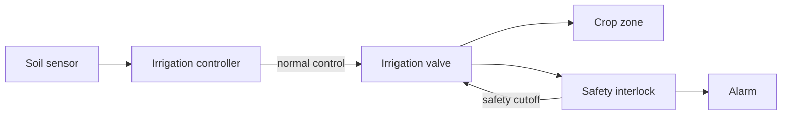

# GraphReact

**An actor runtime you program like React.** Declare a graph of nodes in a `.grx` file, write each node in Python, JavaScript, or Go using hooks, and GraphReact schedules, supervises, and observes them.

GraphReact is a backend runtime, not a UI framework. It renders nothing. "React" describes the programming model: nodes hold state in hooks and react to messages.

> [!NOTE]
> GraphReact is experimental, pre-alpha software at version 0.1.0. There are no published releases yet, so you build it from source. APIs and file formats may change.

## What a graph looks like

A `.grx` file holds your node code and the graph that connects it:

```html
<Ping lang="python">
def body(ctx):
    emit = use_emit()
    def on_pong(msg):
        print("ping received pong", flush=True)
    use_message("pong", on_pong)
    use_effect(lambda: emit("ping", {}), [])
    return {"accepts": ["pong"], "emits": ["ping"]}
</Ping>

<Pong lang="python">
def body(ctx):
    emit = use_emit()
    def on_ping(msg):
        print("pong received ping", flush=True)
        emit("pong", {})
    use_message("ping", on_ping)
    return {"accepts": ["ping"], "emits": ["pong"]}
</Pong>

<Graph id="ping-pong">
  <Ping id="ping" />
  <Pong id="pong" />
  <edge source="ping" target="pong" />
  <edge source="pong" target="ping" />
</Graph>
```

Each node declares what it accepts and emits, and messages travel along the declared edges.

## Features

- **Polyglot nodes:** write node bodies in Python, JavaScript, or Go with the same hook model (`use_state`, `useState`, `UseState`).
- **Fault tolerance:** use Erlang/OTP-style supervision, monitors, links, restart strategies, and process groups.
- **Clustering:** run a graph across hosts with location-transparent addressing over TLS, plus partition detection.
- **Hot reload:** save a `.grx` file and the running graph updates, with rollback if the new code fails on its first tick.
- **Default-deny HTTP ingress:** outside callers reach a node only through message types its manifest explicitly allows.
- **Observability:** get JSON logs, Prometheus metrics, OpenTelemetry traces, a management API, a live event stream, and a terminal UI.
- **Operational security:** includes token and JWT/OIDC authentication, RBAC, secrets, TLS rotation, and hash-chained audit logs.
- **Graph analytics:** includes NetworkX-style algorithms plus Leiden clustering and spectral embeddings, implemented in Rust.
- **Tooling:** includes a formatter, language server, tree-sitter grammar, Dockerfile, and Helm chart.

## Quick start

### Prerequisites

| Tool | Needed for |
|---|---|
| [Rust](https://rustup.rs) (stable) | Building GraphReact |
| [Zig](https://ziglang.org/download/) 0.16+ | Building the native engine bridges |
| Python 3.12+ and `pkg-config` | Building the CLI and running Python nodes |
| [Go](https://go.dev/dl/) | Running Go nodes, including the demo below |

JavaScript nodes use the system JavaScriptCore framework, so they currently run only on macOS. Windows is not supported.

### Build

```sh
git clone https://github.com/Bukola-Oludiran/GraphReact.git
cd GraphReact

# Build the native engine bridges. This must run before cargo build.
cargo xtask zig-build --release

cargo build -p graphreact-cli --bin grx
export PATH="$PWD/target/debug:$PATH"
```

### Run your first graph

Save the [example above](#what-a-graph-looks-like) as `ping-pong.grx`, then run it:

```sh
grx check ping-pong.grx
grx run --runtime=cpython ping-pong.grx
```

The output includes both nodes' messages:

```text
pong received ping
ping received pong
```

> [!TIP]
> Always pass `--runtime`. The default `null` engine checks and mounts the topology without executing node code.

Pass `--watch` to keep the graph running and reload it on every save. It works with `cpython` and `jsc`:

```sh
grx run --runtime=cpython --watch ping-pong.grx
```

## Demo: contain a stuck valve

[`examples/greenhouse-twin`](examples/greenhouse-twin/README.md) simulates a greenhouse as nine Go nodes. When a valve ignores its close command, an independent safety edge shuts it down before the crop is damaged. It is a demonstration, not a safety-certified controller.

This simplified view shows the two paths that can close the valve:



Start the daemon from the repository root:

```sh
grx cluster daemon --dev-loopback \
  --path examples/greenhouse-twin/greenhouse.grx --runtime go
```

`--dev-loopback` is for local use only. It restricts the daemon to a single loopback node with an ephemeral identity.

In a second terminal, select the fault, advance five ticks, and read the result. This uses [`jq`](https://jqlang.org) to shorten the response:

```sh
call() {
  curl -s -X POST http://127.0.0.1:9090/v1/nodes/twin-gateway/call \
    -H 'content-type: application/json' \
    -d "{\"type\":\"$1\",\"reply_type\":\"$2\",\"payload\":${3:-null}}"
}

call set_scenario scenario_set '{"scenario":"stuck_irrigation"}'
for i in 1 2 3 4 5; do call step step_complete > /dev/null; done
call get_snapshot twin_snapshot | jq '.payload | {
  outcome,
  valve: .nodes["irrigation-valve"].status,
  explanation: .risk.explanation
}'
```

```json
{
  "outcome": "contained",
  "valve": "force_closed",
  "explanation": "The normal close command failed, but an independent safety edge force-closed irrigation before crop damage."
}
```

Now try a message type the manifest doesn't declare. The ingress rejects it with HTTP 403:

```sh
call undeclared nope
```

```json
{"error":"rejected_by_manifest","reason":"no matching accepts_external_call entry"}
```

While the daemon runs, inspect it with `grx ps`, or open the terminal UI with `grx observer`. Prometheus metrics are at `http://127.0.0.1:9090/v1/metrics`.

### More examples

- [`examples/greenhouse-twin-ai`](examples/greenhouse-twin-ai/README.md) explains sanitized twin snapshots with the OpenAI API and has no route back to the controls.
- [`examples/openai-go-agent`](examples/openai-go-agent/README.md) compiles the OpenAI Go SDK into a message-driven node.

## Known limitations

- **No sandbox:** node code runs in-process as trusted code. Don't run untrusted code in a node.
- **Mixed-language graphs:** `--runtime=mixed` starts Python, JavaScript, and Go nodes in one graph, but they can't yet message across languages.
- **Durable execution:** `--durability local|cluster` is new and still being hardened.
- **Remote reload:** `grx reload` is a stub. Use `grx run --watch` instead.
- **WebAssembly:** `graphreact-wasm` is a stub.

## Project layout

| Area | Crates | Purpose |
|---|---|---|
| Core | `graphreact-core`, `graphreact-grx-parser` | Scheduler, hooks, supervision, and the `.grx` parser |
| Engines | `graphreact-engine-cpython`, `-jsc`, `-go`, `-null`, `-echo`, `-zig`, `graphreact-codegen-go` | Language runtimes behind a shared engine trait |
| Distributed | `graphreact-dist`, `graphreact-persistence`, `graphreact-durable-runtime` | Clustering and durable execution |
| Operations | `graphreact-cli`, `graphreact-observer`, `graphreact-hotreload`, `graphreact-secrets` | The `grx` binary, telemetry, reload, and secrets |
| Analytics | `graphreact-algorithms`, `graphreact-graspologic`, `graphreact-linalg` | Graph algorithms and statistical analysis |
| Integrations | `graphreact-lsp`, `graphreact-napi`, `graphreact-wasm`, `tree-sitter-grx` | Editor support and language bindings |

## Documentation

- [Onboarding](docs/onboarding.md): reading paths for operators, backend developers, and contributors
- [Architecture](docs/architecture.md): crate tiers, data flow, and invariants
- [Service-level objectives](docs/SLO.md): latency targets and how to verify them
- [Production operations](docs/backend/m-prod-runbook.md): runbook for running daemons
- [Agentic Cloud assessment](docs/agentic-cloud.md): how GraphReact could serve as an agent execution layer
- [Design decisions](docs/decisions/): the reasoning behind major choices

## Development

After the [build steps](#build), run the formatter, linter, core tests, and the greenhouse end-to-end test:

```sh
cargo fmt --all -- --check
cargo clippy --workspace -- -D warnings
cargo test -p graphreact-core -p graphreact-grx-parser -p graphreact-algorithms \
  -p graphreact-linalg -p graphreact-graspologic
cargo test -p graphreact-cli --test greenhouse_twin_e2e
```

On macOS, `cargo test --workspace` may fail to link the JavaScriptCore and CPython bridge tests.

## Acknowledgements

GraphReact's design draws on [Erlang/OTP](https://www.erlang.org) (supervision), [Leptos](https://leptos.dev) (reactive propagation), [Dioxus](https://dioxuslabs.com) (signals), [faer](https://github.com/sarah-quinones/faer-rs) (linear algebra), and [graspologic](https://github.com/graspologic-org/graspologic) (graph statistics).